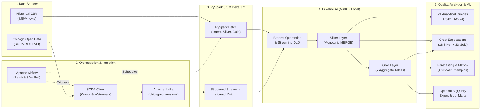
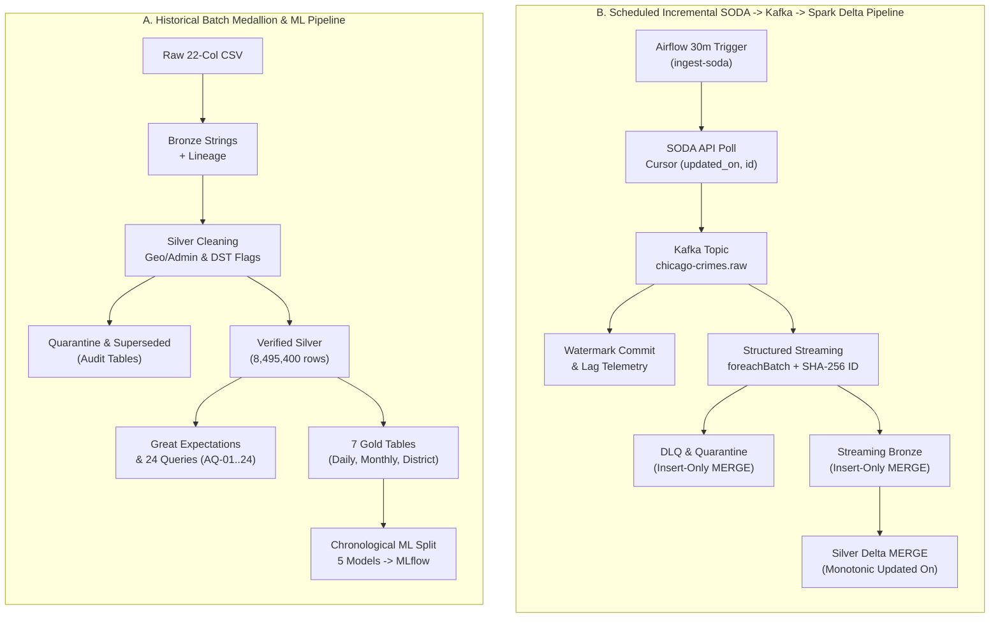
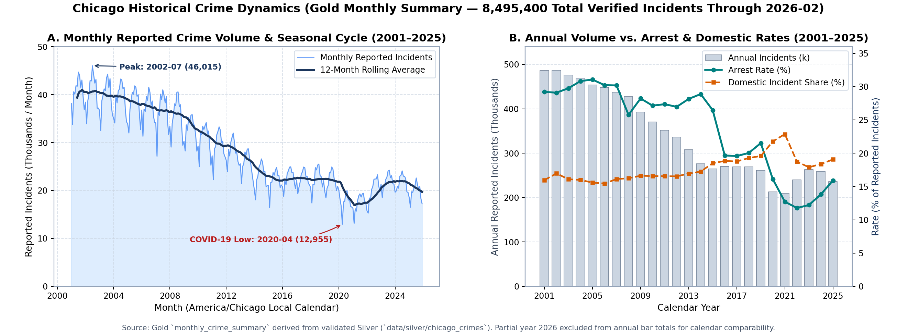
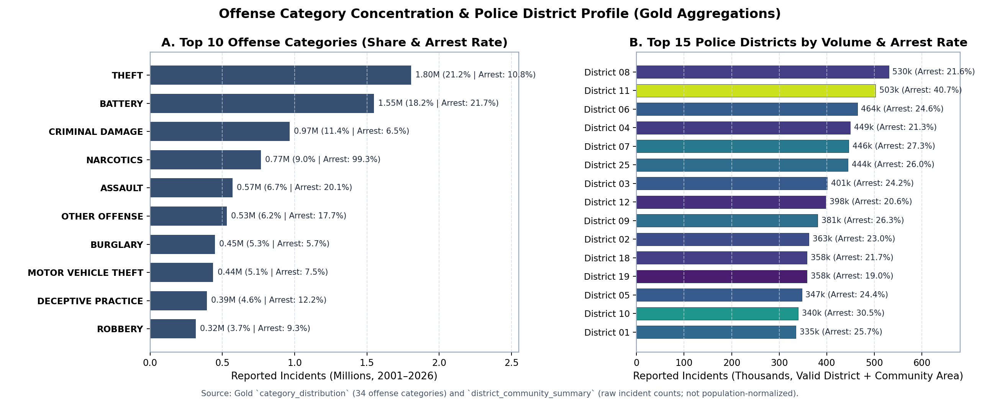
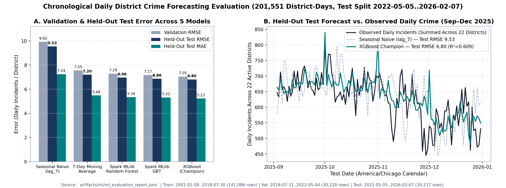

# Chicago Crime Analytics Platform

An end-to-end Lakehouse, incremental streaming, data quality, and time-series forecasting platform built with **PySpark 3.5**, **Delta Lake 3.2**, **Apache Kafka (KRaft)**, **Apache Airflow**, **MinIO (`s3a://`)**, **Great Expectations**, and **MLflow**.

## Overview & Engineering Scope

Public-safety incident datasets combine multi-million-row historical backfills with ongoing record revisions, late-arriving updates, partial or out-of-bounds spatial coordinates, and local Daylight Saving Time (`America/Chicago`) transitions. Naive ingestion pipelines either drop incomplete rows, fabricate centroid coordinates, or allow stale streaming replays to overwrite newer incident states.

This platform processes the official City of Chicago [**Crimes — 2001 to Present (`ijzp-q8t2`)**](https://data.cityofchicago.org/Public-Safety/Crimes-2001-to-Present/ijzp-q8t2/about_data) dataset (`8,495,400` verified historical records) through a unified batch and scheduled incremental architecture that enforces:

- **Strict Medallion Row Accounting**: Every batch and streaming micro-batch reconciles `input_records == accepted_records + superseded_records + quarantined_records` (`8,495,400 == 8,495,400 + 0 + 0` on the historical backfill) without silent row drops or synthetic geographic imputation.
- **Monotonic, Replay-Safe Delta Lake Upserts**: `merge_silver_delta()` orders versions by non-null `Updated On`, prevents null-timestamp payloads from clobbering valid records, upgrades unversioned targets when valid timestamps arrive, and resolves equal-timestamp ties deterministically via SHA-256 business-payload digests.
- **Explicit `America/Chicago` vs. `UTC` Timestamp Contract**: Preserves Chicago wall-clock timestamps (`Date`, `ts`, local calendar features) while deriving unambiguous UTC instants (`ts_utc`) and flagging DST spring-gap (`253` rows) and fall-fold (`1,662` rows) records via `timestamp_dst_flag`.
- **Bounded Scheduled Incremental Catch-Up**: Airflow polls the pull-based SODA REST API using a composite `(updated_on, id)` watermark with configurable multi-page catch-up (`page_size`, `max_pages`, `limit`) and lag/backlog telemetry before publishing to Kafka.
- **Leakage-Free District Crime Forecasting**: Chronological daily district forecasting across `201,551` continuous district-days (`22` active districts), comparing naive baselines, Spark MLlib (`RandomForest`, `GBTRegressor`), and `XGBoost` tracked in MLflow SQLite.

---

## System Architecture

### Diagram A — High-Level Platform Architecture



### Diagram B — Batch vs. Scheduled Incremental Processing Pipelines



> **Architectural Boundary Note**: The City of Chicago SODA endpoint is a REST API rather than a push stream. Incremental updates are polled on a schedule by Airflow (`ingest-soda`), published to Kafka after validation, and merged idempotently into Silver Delta by Spark Structured Streaming. Gold aggregations and ML forecasting models are refreshed by the batch pipeline (`chicago_crimes_batch_pipeline`). Detailed container port mappings and failure-recovery semantics are documented in [docs/architecture.md](docs/architecture.md).

---

## Verified Analytical & Forecasting Results

All figures below are generated reproducibly from the verified Gold tables (`data/gold`) and ML evaluation artifacts (`artifacts/ml/ml_evaluation_report.json`) via [`scripts/generate_readme_visuals.py`](scripts/generate_readme_visuals.py).

### 1. Historical Crime Volume, Seasonality & Enforcement Trends (2001–2025)



- **Long-Term Trajectory**: Across `8,495,400` verified incidents (`302` monthly buckets from `2001-01` through `2026-02` on the `America/Chicago` calendar), annual reported incidents declined by **51.4%** from `485,958` in `2001` (peaking at `46,015` in July `2002`) to `236,322` in `2025`, with a pronounced pandemic trough in April `2020` (`12,955` incidents).
- **Enforcement & Domestic Share Shift**: Citywide arrest rates decreased from `29.21%` (`2001`) to `15.91%` (`2025`), while domestic-related incidents rose from `15.9%` to `19.1%` of total reported volume.

### 2. Offense Category Concentration & Police District Profile



- **Offense Pareto Distribution**: The top four categories—`THEFT` (`1.80M`, `21.2%`), `BATTERY` (`1.55M`, `18.2%`), `CRIMINAL DAMAGE` (`0.97M`, `11.4%`), and `NARCOTICS` (`0.77M`, `9.0%`)—account for **59.8%** of all reported crimes since 2001, while arrest rates vary sharply by offense type (`99.3%` for `NARCOTICS` vs. `6.5%` for `CRIMINAL DAMAGE`).
- **District Volume vs. Arrest Rate**: Reported volume is highest in Districts `08` (`530k`), `11` (`503k`), and `06` (`464k`), whereas District `11` exhibits the highest district-level arrest rate (`40.7%`). Counts reflect raw reported incidents and are not population-normalized.

### 3. Chronological Daily District Forecasting Evaluation



- **Strict Temporal Split (Zero Leakage)**: Evaluated across `201,551` continuous district-day rows (`22` active districts; sparse District `31` excluded via `<50%` calendar coverage; missing district-days zero-filled before lag computation):
  - **Train**: `2001-01-08` .. `2018-07-30` (`141,086` rows)
  - **Validation**: `2018-07-31` .. `2022-05-04` (`30,228` rows)
  - **Held-Out Test**: `2022-05-05` .. `2026-02-07` (`30,237` rows)

| Model | Framework | Val RMSE | Test RMSE | Test MAE | Test $R^2$ | Test WMAPE (%) |
| --- | --- | ---: | ---: | ---: | ---: | ---: |
| `seasonal_naive_lag7` | Baseline | `9.9210` | `9.5328` | `7.2383` | `0.2320` | `23.08%` |
| `rolling_mean_7_baseline` | Baseline | `7.5490` | `7.2003` | `5.4846` | `0.5619` | `17.49%` |
| `spark_mllib_rf` | Spark MLlib | `7.2859` | `6.9566` | `5.3390` | `0.5910` | `17.03%` |
| `spark_mllib_gbt` | Spark MLlib | `7.1733` | `6.8588` | `5.3151` | `0.6024` | `16.95%` |
| **`xgboost_regressor` (Champion)** | **XGBoost** | **`7.0473`** | **`6.8025`** | **`5.2300`** | **`0.6089`** | **`16.68%`** |

---

## Technology Stack

| Layer | Technologies |
| --- | --- |
| **Language & Packaging** | Python 3.11 (`>=3.11,<3.12`), `uv`, Ruff, `pyproject.toml` (`chicago-crimes` CLI) |
| **Distributed Processing** | PySpark 3.5.1, Delta Lake 3.2.0 (`io.delta:delta-spark_2.12:3.2.0`), Hadoop AWS 3.3.4 (`s3a://`) |
| **Incremental Ingestion** | Apache Kafka KRaft (`apache/kafka-native:3.8.1`), SODA API v2 client with composite watermark |
| **Lakehouse Storage** | MinIO (`cgr.dev/chainguard/minio:latest`), local Parquet/Delta, Delta time-travel (`--version`) |
| **Orchestration** | Apache Airflow 2.10.5 (`LocalExecutor`, PostgreSQL 16 metadata DB, containerized Spark dispatch) |
| **Data Quality** | Row accounting invariant (`input = accepted + superseded + quarantined`), Great Expectations 1.25 |
| **Analytics & ML** | 24 registered queries (`AQ-01`–`AQ-24`), XGBoost 3.2, Spark MLlib (`RF`/`GBT`), MLflow 3.18 SQLite |
| **Warehouse Modeling** | `publish-bigquery` staging/DDL manifest exporter (`--dry-run` default), `dbt-bigquery` (`stg` + 3 marts) |
| **Testing & CI** | Pytest (`37` unit + E2E tests, `4` live integration specs), offline `dbt parse`, GitHub Actions CI |

---

## Quick Start

### 1. Local Environment Setup

Prerequisites: Python `>=3.11,<3.12`, **JDK 17** (`JAVA_HOME`), and `uv`.

```bash
cp .env.example .env
uv sync --locked --all-extras
uv run chicago-crimes --help
```

### 2. Local Medallion, Validation, Analytics & Forecasting Pipeline

```bash
# 1. Ingest raw CSV into non-destructive string Bronze Parquet
uv run chicago-crimes --profile local ingest \
  --input data/chicago_crimes.csv \
  --output data/bronze/chicago_crimes

# 2. Run Silver cleaning, timezone/DST enrichment, quarantine routing, and deduplication
uv run chicago-crimes --profile local process --pipeline silver \
  --input data/bronze/chicago_crimes \
  --output data/silver/chicago_crimes

# 3. Materialize all 7 Gold aggregate tables
uv run chicago-crimes --profile local gold \
  --input data/silver/chicago_crimes \
  --output data/gold

# 4. Run Great Expectations validation suites (28 Silver + 23 Gold rules)
uv run chicago-crimes --profile local validate --layer both \
  --silver-input data/silver/chicago_crimes \
  --gold-input data/gold \
  --output artifacts/quality/ge_validation_report.json

# 5. Execute registered analytical queries (AQ-01..AQ-24) and train ML forecasting models
uv run chicago-crimes --profile local analyze --input data/silver/chicago_crimes --output artifacts/analytics
uv run chicago-crimes --profile local ml --gold-input data/gold --output artifacts/ml

# 6. Regenerate README analytical figures from Gold & ML artifacts
uv run python scripts/generate_readme_visuals.py
```

### 3. Containerized Spark Standalone, MinIO, Kafka & Airflow Stack

```bash
# Start MinIO (:9000/:9001), Spark Master + 2 Workers (:8080-:8082), Kafka (:9094), PostgreSQL & Airflow (:8085)
docker compose --profile orchestration build
docker compose --profile orchestration up -d

# Start the continuous Structured Streaming Kafka consumer alongside orchestration
docker compose --profile orchestration --profile streaming up -d

# Run an ad-hoc bounded SODA poll -> Kafka publish batch on the Spark network
docker compose --profile tools run --rm spark-runner \
  python -m chicago_crimes --profile standalone ingest-soda \
  --limit 2000 --page-size 500 --max-pages 5 --publish-kafka
```

---

## Repository Structure

```text
.
├── .github/workflows/ci.yml         # CI: uv lock, ruff, pytest (non-integration), offline dbt parse, compose config
├── compose.yaml                     # Profiled Docker stack (storage, spark, streaming, orchestration, tools)
├── configs/                         # Runtime profiles (default.yaml, standalone.yaml)
├── dbt/                             # BigQuery staging view & 3 mart models + schema/source definitions
├── docs/                            # Architecture, data contract, deployment, verification & limitations
│   └── assets/                      # Reproducible analytical & ML evaluation charts embedded in README
├── infrastructure/                  # Dockerfiles & entrypoints for Spark 3.5 + Delta and Airflow 2.10
├── orchestration/dags/              # chicago_crimes_batch_pipeline & chicago_crimes_incremental_streaming
├── scripts/                         # Reproducible figure generation (generate_readme_visuals.py)
├── src/chicago_crimes/
│   ├── core/                        # Config loading, logging, canonical 22-col schema, SparkSession factory
│   ├── ingestion/                   # CSV Bronze loader, SODA API v2 polling client, Kafka producer
│   ├── processing/                  # Silver cleaning/dedup, America/Chicago features, GE validation, Gold tables
│   ├── analytics/                   # AQ-01..AQ-24 task registry, dataset profiling, shuffle benchmark
│   ├── streaming/                   # Kafka foreachBatch consumer, replay-safe DLQ/Bronze/Quarantine/Silver MERGE
│   ├── storage/                     # Local Parquet, Delta Lake ACID, MinIO S3A, lakehouse & BigQuery adapters
│   ├── ml/                          # Causal lag/rolling feature dataset, chronological splits, trainers & MLflow
│   ├── experiments/                 # PCA, FAMD, imbalance, and sampling studies
│   ├── visualization/               # Matplotlib chart helpers
│   └── cli.py                       # Unified `chicago-crimes` CLI entry point
└── tests/
    ├── unit/                        # Core, Bronze/Silver/Gold, DST/timezone, Delta MERGE, SODA & ML unit tests
    ├── e2e/                         # Full offline CLI pipeline lifecycle test (Bronze -> BigQuery manifest)
    └── integration/                 # Live Docker cluster, Kafka replay recovery & Airflow DAG tests
```

---

## Known Limitations & Provenance

- **Scheduled Polling vs. Push Streaming**: SODA v2 is a pull-based REST API; `chicago_crimes_incremental_streaming` polls on a 30-minute schedule with bounded multi-page catch-up and publishes to Kafka.
- **Per-Sink Replay Idempotency vs. Cross-Sink Two-Phase Commit**: DLQ, Bronze, Quarantine, Silver Delta tables, and JSONL metrics are individually idempotent across Spark checkpoint replays, but Spark does not provide a single distributed transaction across multiple Delta tables and external watermark files.
- **Single-Host Distributed Overhead**: At `100,000` rows under an equal 4-core CPU budget on one machine, `local[4]` completes the shuffle benchmark in `16.633s` (`p=16`) vs. `41.447s` in single-host Docker Spark Standalone due to container IPC and S3A HTTP serialization overhead.
- **BigQuery Dry-Run Scope**: `publish-bigquery` exports Parquet staging files and BigQuery DDL/load manifests locally (`--dry-run` default), and `dbt/` models are verified via offline `dbt parse`; live GCP deployment requires user cloud credentials.
- **Dataset Attribution & Licensing Notice**: Raw and derived data originate from the [City of Chicago Open Data Portal (`ijzp-q8t2`)](https://data.cityofchicago.org/Public-Safety/Crimes-2001-to-Present/ijzp-q8t2/about_data). This repository does **not** currently include an open-source `LICENSE` file; public redistribution requires explicit sign-off from all repository contributors (`denysrozum` formerly `denusbtw`, `Eclipsexc`, `Evilcheshire`, `ThLivSt451`).

## Documentation Index

- **[Architecture Overview](docs/architecture.md)** — Detailed topology diagram, package boundaries, execution profiles, and failure recovery model
- **[Data Contract](docs/data-contract.md)** — Raw 22-column schema, `America/Chicago` vs. `UTC` timestamp rules, Delta `MERGE` policy, and `AQ-01`–`AQ-24` registry
- **[Deployment Guide](docs/deployment.md)** — Prerequisites, `.env` variables, `compose.yaml` profiles/ports, and operational runbook
- **[Verification & Benchmark Evidence](docs/verification.md)** — Phase 3 rebuild impact table, cluster benchmarks, streaming replay proofs, GE results, and ML metrics
- **[Known Limitations](docs/limitations.md)** — Architectural constraints, DST ambiguity handling, BigQuery dry-run scope, and licensing status
