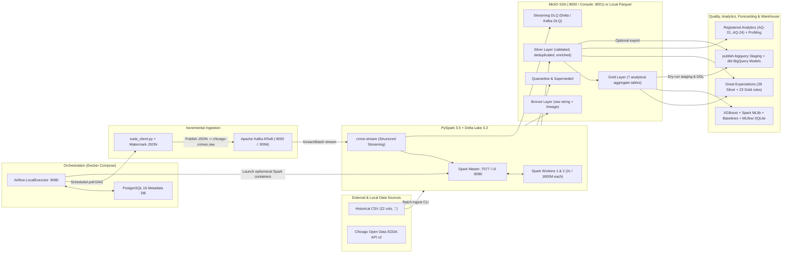

# Chicago Crime Analytics Platform

A modular PySpark, Delta Lake, Kafka, Airflow, Great Expectations, and MLflow data engineering platform for analyzing and forecasting the City of Chicago *Crimes - 2001 to Present* dataset.

## Dataset Attribution & Redistribution Status

- **Upstream Dataset**: City of Chicago Open Data Portal — [Crimes - 2001 to Present (`ijzp-q8t2`)](https://data.cityofchicago.org/Public-Safety/Crimes-2001-to-Present/ijzp-q8t2/about_data)
- **Raw CSV & SODA v2 Feeds**: Not stored in version control; fetched locally or polled incrementally via Socrata Open Data API v2 (`https://data.cityofchicago.org/resource/ijzp-q8t2.json`).
- **License Notice**: This repository does **not** currently include an open-source `LICENSE` file. Public redistribution requires explicit licensing sign-off from repository contributors (`denysrozum` formerly `denusbtw`, `Eclipsexc`, `Evilcheshire`, `ThLivSt451`) and adherence to City of Chicago Open Data terms.

## System Architecture

### Diagram A — Platform Infrastructure & Serving Architecture



### Diagram B — Batch & Scheduled Incremental Processing Pipelines

```mermaid
flowchart TD
    subgraph Batch["Batch Medallion Pipeline"]
        B1["Raw CSV ('RAW_CRIME_STRING_SCHEMA')"] --> B2["Bronze Parquet + lineage"]
        B2 --> B3["Silver normalize, flag geo/admin, deduplicate by ID / Updated On DESC"]
        B3 -->|"Invalid ID, Date, Type, Corrupt"| B4["Quarantine Parquet"]
        B3 -->|"Older duplicate versions"| B5["Superseded Parquet"]
        B3 -->|"Accepted ('input = accepted + superseded + quarantined')"| B6["Silver Dataset"]
        B6 --> B7["Great Expectations Validation"]
        B7 --> B8["7 Gold Tables"]
        B6 --> B9["Analytics AQ-01..AQ-24 & Stats"]
        B8 --> B10["Causal Daily District ML Split -> 5 Models -> Champion Selection"]
    end

    subgraph Streaming["Scheduled SODA-to-Kafka Streaming Pipeline"]
        S1["Airflow Incremental DAG triggers soda_client"] -->|"Query > watermark (updated_on, id)"| S2["Chicago SODA API v2"]
        S2 -->|"Commit watermark only after Kafka ACK"| S3["Kafka topic 'chicago-crimes.raw'"]
        S3 --> S4["Structured Streaming 'foreachBatch' + stream_event_id SHA-256"]
        S4 -->|"Malformed JSON"| S5["DLQ Delta (insert-only MERGE on stream_event_id)"]
        S4 -->|"Valid JSON"| S6["Streaming Bronze Delta (insert-only MERGE on stream_event_id)"]
        S6 --> S7["Silver pipeline accounting"]
        S7 -->|"Rejected rows"| S8["Streaming Quarantine (insert-only MERGE)"]
        S7 -->|"Accepted rows"| S9["Streaming Silver Delta (MERGE on ID by newest Updated On)"]
        S9 --> S10["Atomic temp-replace metrics JSONL log"]
    end
```



## Technology Stack

| Layer | Technologies |
|---|---|
| Language & Packaging | Python 3.11 (`>=3.11,<3.12`), `uv`, Ruff, `pyproject.toml` (`chicago-crimes` CLI) |
| Distributed Processing | PySpark 3.5, Delta Lake 3.2.0 (`io.delta:delta-spark_2.12:3.2.0`), Hadoop AWS 3.3.4 (`s3a://`) |
| Ingestion & Streaming | Apache Kafka KRaft (`apache/kafka-native:3.8.1`), SODA API v2 (`requests` polling client) |
| Storage & Lakehouse | MinIO (`cgr.dev/chainguard/minio:latest`), local Parquet/Delta, Delta time-travel (`--version`) |
| Orchestration | Apache Airflow (`LocalExecutor`, PostgreSQL 16 metadata DB, containerized Spark dispatch) |
| Data Quality | Row accounting invariant (`input = accepted + superseded + quarantined`), Great Expectations |
| Analytics & ML | 24 registered queries (`AQ-01`–`AQ-24`), XGBoost, Spark MLlib (`RF`/`GBT`), MLflow SQLite tracking, `matplotlib` |
| Warehouse Modeling | `publish-bigquery` staging/DDL manifest exporter (`--dry-run` default), `dbt-bigquery` (`stg` view + 3 marts) |
| Testing & CI | Pytest (`34` unit + E2E tests, `4` live integration specs), offline `dbt parse`, Docker Compose check, GitHub Actions |

## Repository Layout

```text
.
├── .github/workflows/ci.yml         # CI: uv lock, ruff, pytest (non-integration), offline dbt parse, compose config
├── compose.yaml                     # Profiled Docker stack (storage, spark, streaming, orchestration, tools)
├── configs/                         # Runtime profiles (default.yaml, standalone.yaml)
├── dbt/                             # BigQuery staging view & 3 mart models + schema/source definitions
├── docs/                            # Detailed architecture, data contracts, deployment, verification & limitations
├── infrastructure/                  # Dockerfiles & entrypoint for Spark 3.5 + Delta and Airflow
├── orchestration/dags/              # chicago_crimes_batch_pipeline & chicago_crimes_incremental_streaming
├── src/chicago_crimes/
│   ├── core/                        # Config loading, logging, canonical 22-col schema, SparkSession factory
│   ├── ingestion/                   # CSV Bronze loader, SODA API v2 polling client, Kafka producer
│   ├── processing/                  # Silver cleaning/dedup, features, accounting, Great Expectations, Gold tables
│   ├── analytics/                   # AQ-01..AQ-24 task registry, profiling, shuffle benchmark
│   ├── streaming/                   # Kafka foreachBatch consumer, replay-safe DLQ/Bronze/Quarantine/Silver MERGE
│   ├── storage/                     # Local Parquet, Delta Lake ACID, MinIO S3A, lakehouse & BigQuery adapters
│   ├── ml/                          # Causal lag/rolling feature dataset, chronological splits, trainers & MLflow
│   ├── experiments/                 # PCA, FAMD, imbalance, and sampling studies
│   ├── visualization/               # Matplotlib chart helpers
│   └── cli.py                       # Unified `chicago-crimes` CLI entry point
└── tests/
    ├── unit/                        # Core, Bronze/Silver/Gold, streaming, lakehouse, GE, ML, CLI unit tests
    ├── e2e/                         # Full offline CLI pipeline lifecycle test (Bronze -> BigQuery manifest)
    └── integration/                 # Live Docker cluster, Kafka replay recovery & Airflow DAG tests
```

## Quick Start

### 1. Local Development Environment

Prerequisites: Python `>=3.11,<3.12`, **JDK 17** (`JAVA_HOME`), and `uv`.

```bash
cp .env.example .env
uv sync --locked --all-extras
uv run chicago-crimes --help
```

### 2. Local Batch, Validation, Analytics & Forecasting Flow

```bash
# Ingest raw CSV into non-destructive string Bronze Parquet
uv run chicago-crimes --profile local ingest \
  --input data/chicago_crimes.csv \
  --output data/bronze/chicago_crimes

# Run Silver cleaning, normalization, quarantine routing, and deduplication
uv run chicago-crimes --profile local process --pipeline silver \
  --input data/bronze/chicago_crimes \
  --output data/silver/chicago_crimes

# Materialize all 7 Gold aggregate tables
uv run chicago-crimes --profile local gold \
  --input data/silver/chicago_crimes \
  --output data/gold

# Run Great Expectations validation suites (28 Silver + 23 Gold rules)
uv run chicago-crimes --profile local validate --layer both \
  --silver-input data/silver/chicago_crimes \
  --gold-input data/gold \
  --output artifacts/quality/ge_validation_report.json

# List or execute registered analytical tasks (AQ-01..AQ-24)
uv run chicago-crimes analyze --list
uv run chicago-crimes --profile local analyze \
  --input data/silver/chicago_crimes \
  --output artifacts/analytics

# Train chronological daily district crime forecasting models
uv run chicago-crimes --profile local ml \
  --gold-input data/gold \
  --output artifacts/ml

# Plan BigQuery schema/DDL/staging export locally without GCP credentials (dry-run default)
uv run chicago-crimes --profile local publish-bigquery \
  --project local-dry-run \
  --dataset chicago_crimes_gold \
  --gold-input data/gold \
  --silver-input data/silver/chicago_crimes \
  --output artifacts/bigquery/publish_manifest.json
```

### 3. Containerized Spark, MinIO, Kafka & Airflow Stack

```bash
# Start MinIO (:9000/:9001), Spark Master/2 Workers (:8080-:8082), Kafka (:9094), PostgreSQL & Airflow (:8085)
docker compose --profile orchestration build
docker compose --profile orchestration up -d

# Start the continuous Structured Streaming Kafka consumer alongside orchestration
docker compose --profile orchestration --profile streaming up -d

# Run an ad-hoc SODA poll -> Kafka publish batch on the Spark network
docker compose --profile tools run --rm spark-runner \
  python -m chicago_crimes --profile standalone ingest-soda --limit 250 --publish-kafka
```

See [Deployment Guide](docs/deployment.md) for port mappings, environment variables, safe shutdown without deleting persistent volumes, and troubleshooting.

## Verified Engineering Highlights

- **Full-Dataset Medallion Accounting (`8,495,400` rows)**: Reconciles `accepted + superseded + quarantined == input`, preserving missing (`94,765`) and out-of-bounds (`149`) coordinates via non-destructive flags (`has_valid_geo`, `geo_quality_flag`) alongside administrative quality flags (`616,418` missing, `76` out-of-bounds nullified).
- **Great Expectations**: `28/28` Silver rules and `23/23` Gold rules validated cleanly against materialized tables.
- **24 Analytical Tasks (`AQ-01`–`AQ-24`)**: Preserved across `temporal` (`AQ-01`–`AQ-06`), `geographic` (`AQ-07`–`AQ-13`), `categories` (`AQ-14`–`AQ-19`), and `arrests` (`AQ-20`–`AQ-24`), supporting both Parquet and Delta time-travel (`--format delta --version N`).
- **Chronological Forecasting & MLflow**: Leakage-free lag and rolling features across `201,564` continuous district-day rows spanning `22` Chicago police districts; `xgboost_regressor` achieved validation RMSE `6.9617` and held-out test RMSE `6.8346` (MAE `5.2601`, R2 `0.6075`, WMAPE `16.7729%`), outperforming `seasonal_naive_lag7`, `rolling_mean_7_baseline`, `spark_mllib_rf`, and `spark_mllib_gbt`.
- **Replay-Safe Streaming & Benchmark**: Kafka replay and Delta idempotency tested across clean ingest (batch 0: `250` records) and mixed replay/stale/invalid/malformed DLQ recovery (batch 1: `13` records); equal-budget benchmark (`4` cores at `100,000` rows, `p=16`) measures `16.633s` in `local[4]` vs `41.447s` in single-host Docker Spark Standalone.
- **Test & Quality Verification**:
  - Offline CI suite (`uv run ruff check src tests orchestration`, `uv run pytest -m "not integration" -v`, offline `dbt parse`, `docker compose --profile orchestration config --quiet`).
  - Live integration tests (`pytest -m integration`) exercise distributed cluster execution, streaming replay crash recovery, and Airflow DAG runs when Docker services are active.

## Documentation

- [Architecture Overview](docs/architecture.md) — Package boundaries, execution profiles, batch/streaming internals, and failure recovery model
- [Data Contract](docs/data-contract.md) — Raw 22-column CSV schema, Bronze/Silver/Gold/DLQ/Quarantine schemas, quality flags, dbt marts, and `AQ-01`–`AQ-24` mapping
- [Deployment Guide](docs/deployment.md) — Prerequisites, `.env` variables, `compose.yaml` profiles/ports, startup, verification, and troubleshooting
- [Verification & Benchmark Evidence](docs/verification.md) — Observed counts, streaming replay verification, Airflow runs, GE gates, benchmark timings, and ML metrics
- [Known Limitations](docs/limitations.md) — Polling vs push latency, cross-sink atomicity bounds, small-scale distributed overhead, BigQuery dry-run scope, and licensing status
